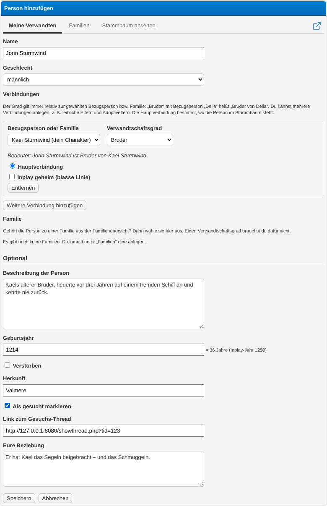
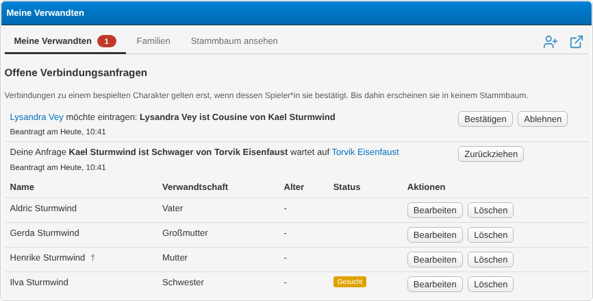
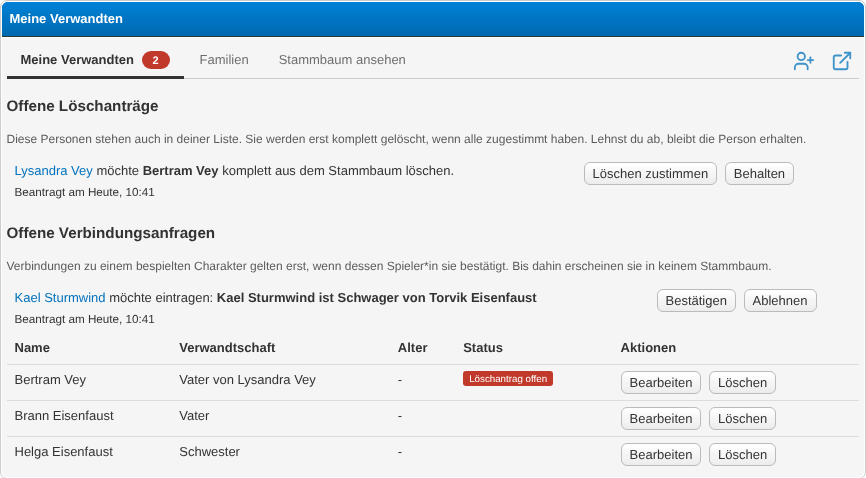
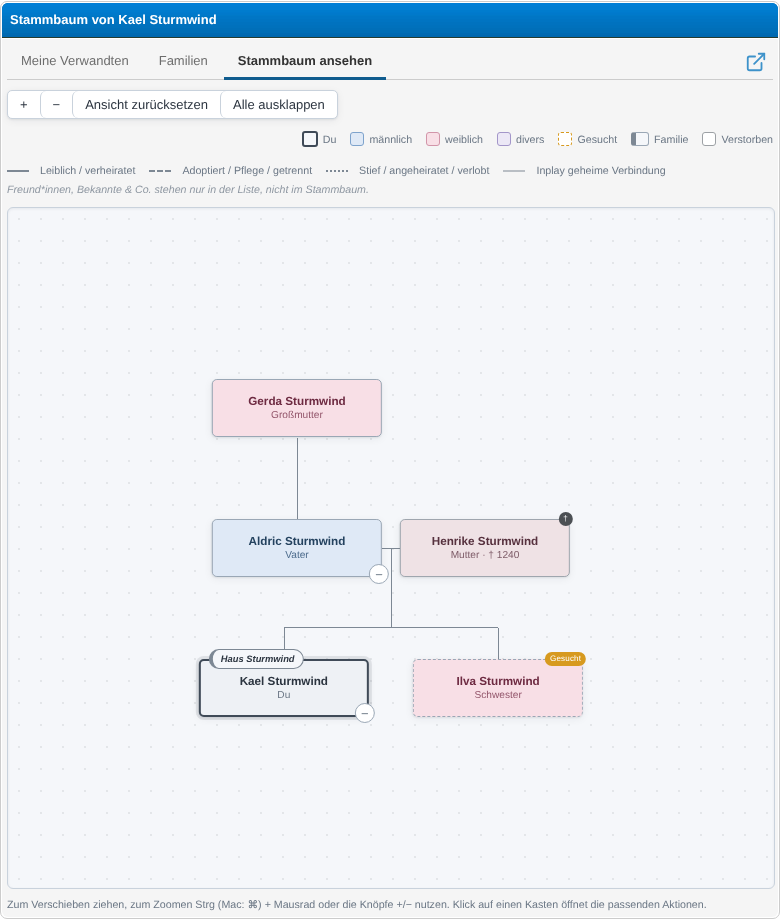
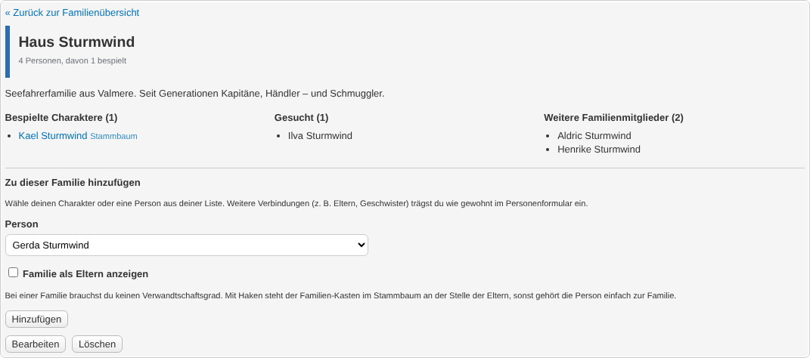
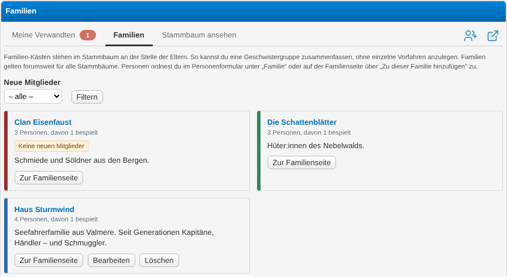
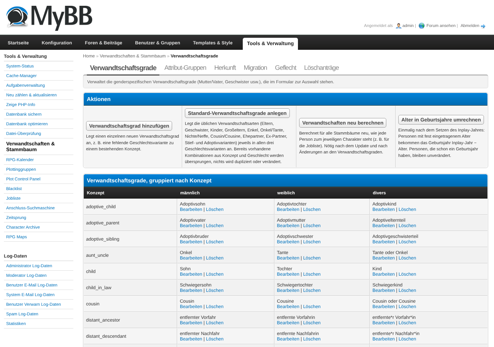

# Relatives & Family Tree

A MyBB 1.8 plugin for character-based roleplay forums. Players record the relatives and other
close persons of their character – with gender, year of birth, origin, description and
custom attributes – mark open roles as *wanted* (with a link to the wanted thread) and explore
everything in an interactive, clickable family tree. The tree is one shared network for the
whole forum: every person and every statement ("Delia is the mother of Louisa") exists exactly
once, and confirmed account links let visitors click from one character's tree into the next.

Built for RPG forums, where family backgrounds are shared between many players and a character
sheet alone can't show who belongs to whom.

## Requirements

- MyBB 1.8.x
- PHP 7.4 or 8.x
- MySQL 5.7+ / MariaDB 10.2+ (InnoDB)
- **No dependencies.** Optional integrations: the *jobliste* plugin (job list) picks up persons
  through provider hooks, and *anschluss suchmaschine* (connection search) queries wanted roles
  through the public API. Both are separate plugins and not required.
  [MyAlerts](https://github.com/euantorano/MyAlerts) is optional as well: with it, members are
  notified about deletion requests for NPCs. Without it, open requests still show up under
  *My relatives*.

## Installation

1. Upload the contents of this repository into your MyBB root directory (the folders `admin/`
   and `inc/` merge with the existing ones, `relatives.php` goes next to `index.php`).
2. **ACP → Configuration → Plugins** → *Verwandtschaften & Stammbaum* → **Install & Activate**.
3. **ACP → Configuration → Settings → Relatives & Family Tree** → review the settings (see
   [Configuration](#configuration)).
4. **ACP → Tools & Maintenance → Relatives & Family Tree → Relationship types** → click
   **Create default relationship types**. The plugin ships without any relationship types, so
   the add-person form stays empty until you do this (or create your own types).
5. The wanted box `{$relatives_wanted_box}` is inserted automatically on activation into every
   `member_profile` template of every template set – right before `{$signature}`, or before
   `{$footer}` if the template has no signature variable, and only where it is still missing.
   You may move it anywhere; re-activating leaves it there. If your theme renders the profile
   from its own templates (e.g. `member_profile_chara` loaded from `member_profile`), insert
   `{$relatives_wanted_box}` there manually – the plugin only touches `member_profile`.
6. Optional – show the tree link in the profile: **ACP → Templates & Style → Templates →
   *your template set* → Member Templates → `member_profile`** and insert
   `{$relatives_tree_link}` where it should appear.

Upgrading from the legacy *relatives*/*wanted* plugin (v1.x)? Follow
[Migrating from the legacy plugin](#migrating-from-the-legacy-plugin) before your users start
adding persons.

## Usage

### First steps after activation

1. Create the default relationship types (Installation step 4) and adjust labels if needed.
2. Optionally create attribute groups (e.g. blood status) under
   **ACP → Tools & Maintenance → Relatives & Family Tree → Attribute groups**.
3. Optionally set the **Current in-play year** under **ACP → Configuration → Settings →
   Relatives & Family Tree**. Persons then get a year of birth instead of a fixed age, and the age
   is always calculated from it. Convert existing ages once via **… → Relationship types →
   Convert ages to years of birth**.
4. Decide where the "origin" of a person comes from (free text or an existing profile field)
   under **… → Origin**.
5. Tell your players where to find it: **User CP → Miscellaneous → Relatives & Family Tree**.

### For players: managing relatives

Open **User CP → Miscellaneous → Relatives & Family Tree**. The page has three tabs: *My
relatives*, *Families* and *View family tree*; the icon on the right adds a person (or family),
the pop-out icon opens your tree in its own window.

**Add a person:** click the add icon on *My relatives*.

- **Name** – if a person with exactly this name already exists in the network, no duplicate is
  created; you are connected to the existing person instead and only empty fields are filled.
- **Gender** – choose it first: the relationship dropdown then only offers the fitting labels
  (e.g. *mother* for female, *parent* for diverse/unspecified).
- **Connections** – one or more statements "this person is *&lt;relationship&gt;* of
  *&lt;person&gt;*". The anchor is your own character by default, but can be any person in your
  tree (e.g. *brother* of *your mother* = your uncle). Each connection can be marked **Secret
  in-play (faded line)** and one of them is the **Main connection** that positions the person in
  the tree. *Secret in-play* only draws the line faintly (e.g. a parentage the characters don't
  know about) – it does **not** hide anything. Choose *Other connection* and type a free label
  for friends, rivals, lovers etc. – such connections are listed under *My relatives* but are
  **not** drawn in the family tree.
- **Family** – assign the person to one or more families from the family overview, no
  relationship degree needed. With **Show family as parents** the family box takes the place of
  the parents in the tree; without it the person simply belongs to the family.
- **Optional details**, in this order:
  - **Description of the person**
  - **Year of birth** (or **Age** if no in-play year is set) – with a year of birth the form
    shows the resulting age next to the field.
  - **Deceased** – only when ticked, **Year or date of death** appears; shows a cross and a
    dimmed box in the tree. If it contains a year and the person has a year of birth, the age is
    shown as the age at death instead of the age in the current in-play year.
  - **Origin**
  - **Occupation** – only with the *jobliste* plugin, which adds its own fields here.
  - **Mark as wanted** – only when ticked, **Link to the wanted thread** appears; the person then
    appears as a wanted card in the profile of every character whose family tree contains them
    (see [Wanted box in the profile](#wanted-box-in-the-profile)).
  - **Attributes** – the attribute groups configured in the ACP.
  - **Your relationship** – personal to your character; everything else is shared with everyone
    who has this person in their list.

**Edit:** use the *Edit* link in your list or the box menu in the tree.

**Connections to other players' characters need their confirmation.** If you add or change a
connection to a character that another member plays (e.g. "Norah is the second cousin of my
character"), it is not saved right away:

1. You see the notice *… waiting for confirmation by their player*. The connection does not
   appear in any tree yet.
2. The other player gets a MyAlert (if MyAlerts is installed) and sees the request under
   **User CP → Relatives & Family Tree → My relatives → Open connection requests** (also counted
   in the red badge next to *My relatives*). There they click **Confirm** or **Decline**.
3. After confirming, the connection is added and the other person also appears in the confirming
   player's *My relatives* list. Either way you get a notification.
4. Your own open requests are listed in the same box; **Withdraw** cancels them.

Accounts of the same player (Account Switcher) don't need to confirm each other.

**Connections added by others:** at the bottom of a person's edit form, the section
*Connections added by others* lists connections that were stored at the other person (e.g.
"Nick is great-grandfather of Sienna", entered from Nick's side). You can **Change** the degree
or **Remove** the connection there without being allowed to edit the other person. Removing
always works immediately, from both sides – also with the **×** next to a connection in the
tree panel.

**Delete an NPC (deletion request):** NPCs belong to the shared network, so *Delete* (in your
list or in the tree's box menu) asks everyone else who has the person in their list:

1. If nobody else lists the person, they are deleted right away – together with all their
   connections.
2. Otherwise a **deletion request** is created. Everyone else who lists the person gets a MyAlert
   (if MyAlerts is installed) and sees the request under **User CP → Relatives & Family Tree →
   My relatives → Open deletion requests** (a red counter next to *My relatives* shows how many
   are waiting). There they click **Agree to delete** or **Keep**.
3. Once **everyone** has agreed, the person is deleted completely and the requester is notified.
4. If **anyone** clicks *Keep*, the request fails: the person stays in the network, the requester
   is removed from the person's list and is notified.

While a request is open, the requester's list shows *Deletion requested (x/y approvals)*. There
is no deadline; the team can decide stuck requests in the ACP (see below). Everything you do
gets a short confirmation message – in the list as a redirect notice, in the tree as a status
message at the bottom of the screen.

**Played characters** are never deleted this way: *Delete* only takes them off **your** list.

**Who may edit a person?** Everyone who has the person in their list, everyone whose character
belongs to the same family, the account of a played character (for its own node) and the team
(moderators/admins). Everybody else sees the person but can take them over via **Add to my
list** in the tree.

### The family tree

**User CP → Relatives & Family Tree → View family tree** (or the *Family tree* link in a
profile/postbit/member list).

- Drag to pan; zoom with **Ctrl/⌘ + mouse wheel** or pinch (in the popup the plain wheel zooms).
- Click a box to see all its connections in plain words ("Brother of Delia · Husband of Ava");
  entries jump to the respective box. Hovering a box highlights exactly its lines.
- The box menu adds a relative *of this person*, edits the person or takes them into your list.
- **What is shown right away:** every blood relative of the character (ancestors and all their
  descendants, however distant), the character's own adoptive/step/foster family, and the
  partners and co-parents of all of them. The families in-laws come from stay folded: an in-law
  carries a small **origin label** on the top edge of their box (e.g. *Travers* on a
  married-in Rebecca) – click it to open that family's panel.
- Boxes with **…** have more relatives behind them (an in-law's parents, a cousin's adoptive
  family …) – click to unfold that branch.
- **Expand all** in the toolbar shows everything connected to the character at once (very large
  networks are capped; a notice tells you so). **Default view** switches back.
- **Layout:** one row per generation; couples always stand side by side, siblings by year of
  birth (estimated from the age if only that is kept), parents centred above their children. A
  married couple is the seam between two families – the wife's siblings on one side, the
  husband's on the other. The rows closest to the character get priority; older side lines move
  further out when space runs short.
- Played characters (confirmed account links) are clickable and open their own tree.
- Uncertain intermediate persons are shown as grey **placeholders** ("Parent of Jolina") instead
  of a misleading direct line, e.g. for aunts, cousins or in-laws whose parents nobody has
  entered yet. Placeholders are display only and vanish once the real person is added.
- Line styles come from the relationship type (e.g. dashed for ex-spouses); secret in-play
  connections are faint, adoptive/second families get their own colour.
- Only relatives are drawn: connections with a free label (friends, clique, rivals …) stay in
  the list.
- The **×** next to a connection in the panel removes it (if you may edit one of the two
  persons).

**Popup & sharing:** the pop-out icon opens the tree without the forum layout. The popup URL can
be shared – it is read-only for everyone except the tree owner and is visible to guests too
(guests still need the usergroup permission *Can view board*). Note: the shared popup shows
secret connections as well.

### Wanted box in the profile

Every character's profile shows a compact **Wanted** box listing all **relatives** marked as
*wanted* that appear in that character's family tree – including persons other members
entered, closest relatives first. Wanted friends or other non-relatives are not shown (other
plugins can add their own cards, see [For developers](#for-developers)). Each mini card shows
the first letter of the name, the name, the relation to the character, the
age and – with the *jobliste* plugin – the occupation. **More** unfolds the
description, **To the wanted thread** opens the linked thread. Characters without wanted
persons in their tree get no box at all.

The box is inserted into `member_profile` automatically (see [Installation](#installation)).
Themes can adjust it with the CSS variables `--relatives-wanted-color` (accent colour) and
`--relatives-wanted-description-height` (height of the unfolded description before it scrolls).

### Linking a person to a real account

When a relative is played by another member, open the person's edit form, scroll to **Link
to an account**, enter the **Username to link this person with** and submit. The other member
receives a private message and sees the request on their *My relatives* page (with a link to
your tree) and can **accept** or **decline**. Only after acceptance is the person shown as a
played character, clickable into their tree, and the *wanted* flag is cleared automatically.

The PM is sent through MyBB's regular PM flow, so MyAlerts, Account Switcher and similar
plugins are notified as usual.

### Families

**User CP → Miscellaneous → Relatives & Family Tree → Families** lists all family boxes of the
forum, two per row: name, *X persons, Y of them played*, family attributes (e.g. blood status),
the *No new members* badge and the beginning of the description. Click the name or **Open family
page** for the family's own page. **Add family** asks for a **Name**, a **Colour**, a
**Description** (MyCode/BBCode and HTML allowed; script tags and JavaScript are filtered out),
**This family welcomes new members** and any family attributes (ACP). A family
box appears in the tree one generation above its members.

**Family page** (`relatives.php?action=family&id=…`): the full description, the attributes and
all members grouped into *Played characters* (profile link, *Family tree* opens their tree
popup), *Wanted* and
*Other family members*. Logged-in members find **Add to this family** there: pick your own
character or a person from your list, optionally tick **Show family as parents**, and click
**Add**.

- Assign families in the person form under **Family** or on the family page. Without *Show
  family as parents* it is a plain membership; with it the box takes the place of the parents.
- Membership covers everyone attached to the box, their (half-)siblings, all descendants
  (including adopted children) and their partners. Adoptive and step siblings do **not** carry
  the membership over – enter an adopted person as *adoptive child* of the family or of its
  parents instead.
- If **This family welcomes new members** is off, no further *played* characters can join the
  family – new players can only take over NPCs already in the tree. The overview shows a
  *No new members* badge.
- The creator of a family, the team and every played character belonging to the family can edit it; only the creator and the team can delete it.
- The overview can be filtered by "welcomes new members" and by family attributes; filter URLs
  can be shared.

**Public family list:** `relatives.php?action=family_list` shows the same cards read-only; the
family pages are public as well (same guest setting). On the *Families* tab the pop-out icon in the
navigation opens this list in a new tab. It can be embedded into an existing list layout
(see settings *Family list: frame template* / *navigation template*).

### For administrators: ACP pages

All pages are under **ACP → Tools & Maintenance → Relatives & Family Tree**. Super administrators
have access right away; other administrators need **ACP → Users & Groups → Admin Permissions →
*user or group* → Tools & Maintenance → Can manage Relatives & Family Tree?**.

- **Relationship types** – gender-specific labels grouped by a *Concept key* (e.g. `parent` with
  *Father* / *Mother* / *Parent*). Fields: **Concept key**, **Gender** (male/female/diverse
  label), **Label**, **Generation offset** (-2 grandparents … +2 grandchildren), **Line style in
  the tree**, **Sort order**, **Active**. If a concept has no diverse variant, users who pick
  *diverse/unspecified* get a hint instead of that option. **Create default relationship types**
  adds all missing standard types; **Recalculate relations** rebuilds the cached "how is this
  person related to the character" for every tree; **Convert ages to years of birth** turns
  fixed ages into years of birth once (in-play year − age, requires the *Current in-play year*
  setting).
- **Attribute groups** – groups and their options. **Applies to** persons, families or both;
  **Field type** *Preset* (dropdown) or *Free text* (families only); **Multiple values for
  persons** switches between one value and checkboxes.
- **Origin** – free-text origin or the options of an existing profile field (enter its **Profile
  field ID (fid)**).
- **Migration** – import from the legacy plugin (see below).
- **Shared network** – preview and merge of the per-character lists into the shared network,
  the list of contradicting statements (accept/discard) and a tool to take back guesses made by
  the legacy migration.
- **Deletion requests** – all open deletion requests for NPCs with requester, date, approvals and
  the members who have not answered yet. **Delete now** carries the request out without waiting;
  **Discard** keeps the person and removes the requester from its list (the requester is
  notified in both cases).

### Migrating from the legacy plugin

The legacy tables (`relatives`, `relatives_status`, `wanted`, `wanted_status`,
`relatives_options`) are read, never modified. **Back up your database first.**

1. Install and activate this plugin. While legacy tables exist, the frontend stays locked
   ("not merged yet") so nobody works on half-migrated data.
2. **ACP → Tools & Maintenance → Relatives & Family Tree → Migration**: check the preview (every
   old relationship label and how it will be mapped, persons/assignments that will be taken over
   or skipped), then click **Run migration**. It stops before writing anything if a used legacy
   label can't be mapped.
3. **… → Shared network**: check the preview and click **Merge network now**. Persons named like
   an account become that character's node, identical names are merged, contradictions go to a
   conflict list you can resolve afterwards. After the merge the frontend is unlocked.
4. **… → Relationship types → Recalculate relations** (the merge does this once, run it again
   after bulk corrections).

A fresh installation **without** legacy tables is unlocked immediately.

### Tips & Tricks

- Anchor connections at the closest known person: "brother of my mother" is stored as such
  and the tree works out that he is your uncle – better than "uncle of me", which leaves open
  on which side he belongs.
- Siblings are derived: a new "brother of Oliver" is automatically a sibling of Oliver's
  siblings. Don't add these connections by hand.
- Separation: switch *Spouse* to *Ex-spouse* – the line becomes dashed.
- Not every attribute group is useful for every forum: deactivate groups you don't need (e.g.
  hair or eye colour) under **ACP → … → Attribute groups**; existing values are kept.
- Keep the *Current in-play year* up to date – all ages in trees, lists and profiles follow it
  automatically.
- Relations beyond great-grandparents / second cousins are shown as *distant ancestor /
  descendant / relative*; the tree still draws the exact structure.
- Template variables: `{$relatives_tree_link}` and `{$relatives_wanted_box}` (template
  `member_profile`, the latter is inserted automatically), `{$post['relatives_tree_link']}` (`postbit`, `postbit_classic`),
  `{$user['relatives_tree_link']}` (`memberlist_user`).

## Configuration

**ACP → Configuration → Settings → Relatives & Family Tree**

- **Plugin active** – master switch. When off, `relatives.php` shows a notice; the User CP menu
  item stays visible.
- **Maximum persons per user** – abuse protection, `0` = unlimited.
- **Origin source** – *Free text* or *Profile field* (see ACP → … → Origin).
- **Origin profile field (fid)** – profile field used as option list when the source is
  *Profile field*.
- **Family list for guests** – whether guests may open the public family list.
- **Family list: frame template** (optional) – name of an existing template the family list is
  embedded into (e.g. `listen`). It receives the content as `{$listen_content}` /
  `{$relatives_family_list_content}`, the navigation as `{$listen_nav}` / `{$relatives_list_nav}`
  and the title as `{$headline}`. Empty = the plugin's own page.
- **Family list: navigation template** (optional) – template with the list navigation (e.g.
  `listen_nav`), only used together with the frame template.
- **Family tree link in profile** / **in postbit** / **in member list** – show a *Family tree*
  link (opens the popup) in the respective place; requires the template variables above.
- **Current in-play year** – the year the in-play takes place in. If set, persons get a year of
  birth and their age is calculated from it; empty = the old fixed *Age* field.
- **Last legacy migration** and **Shared network merged** – set automatically, don't edit.

## For developers

Other plugins must not read the `relatives_*` tables directly. Public contract:

- `relatives_search_persons(array $filters): array` – search persons. Filters (all optional):
  `gender`, `relationship_type_id`, `attribute_option_ids` (array), `is_wanted` (default
  `true`), `age_min`, `age_max` (calculated age), `query` (name/description), `owner_uids`
  (int list – persons added by at least one of these accounts), `ids` (int list), plus paging
  `limit`, `offset` and `order` (`name` = default, `age`, `newest`). Each row contains `age`
  (calculated from the year of birth when an in-play year is set) and `birth_year`; every entry
  in `owners` also has `relationship_description` (the owner's own text about the person).
  Values are sanitized but **not** HTML-escaped – escape when rendering.
- `relatives_count_persons(array $filters): int` – number of matches for the same filters
  (`limit`/`offset`/`order` are ignored), for pagination.
- `relatives_get_relation(int $person_id, int $uid): array` – how a person relates to a
  character: `concept_key`, `label`, `category`, `up`, `down`, `owner_name`, `text`
  (e.g. "Uncle of Megan").
- Provider hooks for *jobliste*: `jobliste_collect_entities`, `jobliste_resolve_entity_label`
  (the latter also fills the optional `relations` list – who added the person and in which
  degree – shown in the info icon of the jobliste overview – and `linked_uid` for persons with a
  confirmed account link).
- `relatives_collect_person_details` (provider hook, `$args = ['person_ids' => [...],
  'linked_uids' => [person_id => uid], 'details' => []]`, `linked_uids` = confirmed accounts of
  played characters): set `$args['details'][$person_id]['job']` to a plain-text occupation; it is shown in
  the tree panel, the list and the wanted cards.
- Person form hooks (all with `person_id` – `0` for a new person in `relatives_person_validate` –,
  `linked_uid` – account of a played character, else `0` – and `uid` – the editing user):
  - `relatives_person_form_fields` (`+ 'html' => ''`): append your own, already escaped form fields;
    they appear in the person form between *Origin* and *Mark as wanted*. Use unique input names.
  - `relatives_person_validate` (`+ 'errors' => []`): runs before anything is written; add plain-text
    error messages to abort saving. The tree quick-add form posts to the same action without your
    fields – only validate when your fields were submitted.
  - `relatives_person_saved` (`+ 'is_new' => bool`): runs after saving; store your fields here.
- `relatives_profile_wanted_cards` (provider hook, `$args = ['uid' => …, 'cards' => '', 'count'
  => 0]`): append your own, already escaped card HTML to `cards` and raise `count` – e.g. wanted
  non-relatives from a search plugin.

## Uninstallation

1. **ACP → Configuration → Plugins** → *Verwandtschaften & Stammbaum* → **Deactivate**. This removes
   the templates, the stylesheets from all themes and the User CP menu item; your data and
   settings are kept.
2. **Uninstall** – drops all `relatives_*` tables and removes the settings. This deletes all
   persons, connections, families, deletion and connection requests irrevocably, and removes the plugin's
   MyAlerts alert types together with their alerts. Legacy tables of the old plugin are not
   touched.
3. Delete the uploaded files (`relatives.php`, `inc/plugins/relatives.php`,
   `inc/plugins/relatives/`, `admin/modules/tools/relatives.php`, the `relatives.lang.php`
   files in `inc/languages/*/` and `inc/languages/*/admin/` and the `relatives_myalerts.lang.php`
   files in `inc/languages/*/`).
4. Remove the template variables you added manually (`postbit`, `memberlist_user`,
   `{$relatives_tree_link}` in `member_profile`, …). `{$relatives_wanted_box}` is removed
   automatically on deactivation.

## Changelog

See [CHANGELOG.md](CHANGELOG.md).
